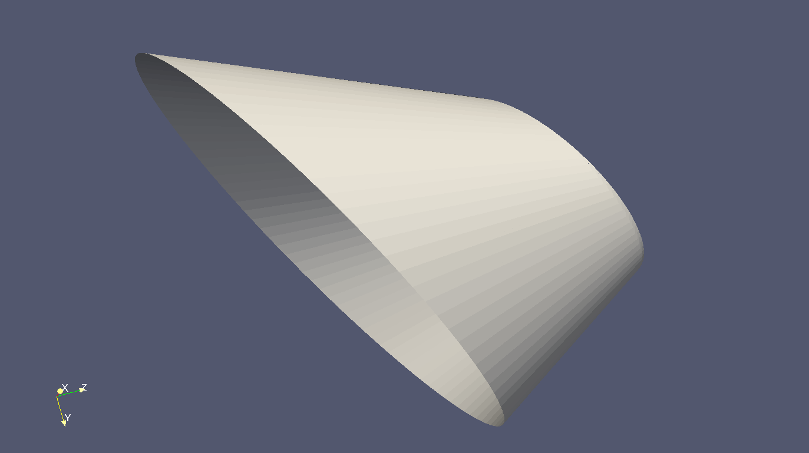

.. _complex-kgeobag-label:

Complex Shapes in KGeoBag
=========================

This section describes the more complicated shapes available in *KGeoBag*. Since as of yet, *KGeoBag* lacks the ability
to perform boolean operations on solids (constructive solid geometry), shapes which cannot be represented as an assembly
of basic shapes must be explicitly defined in C++. However, to augment the basic shapes, *KGeoBag* provides some
additional complex shapes that are commonly encountered in experimental structures such as vacuum chambers, etc.

Some of the examples in this section make use of the the more advanced features of the XML parser, including loops,
conditional statements, and equation evaluation.

Surfaces
----------

Pump Port Surface
~~~~~~~~~~~~~~~~~~

.. xml-element:: port_housing_surface

Conic Section Pump Port Surface
~~~~~~~~~~~~~~~~~~~~~~~~~~~~~~~~~

.. xml-element:: conic_section_port_housing_surface

Beam Surface
~~~~~~~~~~~~~~

.. xml-element:: beam_surface

Multi-cut surfaces
"""""""""""""""""""

The beam shape can also be used to create more complex objects, such as a cut cone with two more cuts at both ends.

An XML example is as follows:

.. code-block:: xml

    <beam_surface name="example_multicut_surface">
        <beam longitudinal_mesh_count="60" axial_mesh_count="60">
            <define name="z_start" value="-1."/>
            <define name="z_end" value="1."/>
            <define name="radius_start" value="2."/>
            <define name="radius_end" value="1."/>
            <define name="phi_start" value="0."/>
            <define name="theta_start" value="30."/>
            <define name="phi_end" value="90."/>
            <define name="theta_end" value="30."/>
            <define name="poly" value="100"/>
            <loop variable="i" start="0" end="[poly]" step="1">
                <start_line x1="{[radius_start]*(cos(2.*TMath::Pi()*([i]/[poly]-[phi_start]/360.))*cos([phi_start]/180.*TMath::Pi()) - sin(2.*TMath::Pi()*([i]/[poly]-[phi_start]/360.))*sin([phi_start]/180.*TMath::Pi()))}"
                                y1="{[radius_start]*cos([theta_start]/180.*TMath::Pi())*(cos(2.*TMath::Pi()*([i]/[poly]-[phi_start]/360.))*sin([phi_start]/180.*TMath::Pi()) +sin(2.*TMath::Pi()*([i]/[poly]-[phi_start]/360.))*cos([phi_start]/180.*TMath::Pi()))}"
                                z1="{[radius_start]*sin([theta_start]/180.*TMath::Pi())*(cos(2.*TMath::Pi()*([i]/[poly]-[phi_start]/360.))*sin([phi_start]/180.*TMath::Pi()) +sin(2.*TMath::Pi()*([i]/[poly]-[phi_start]/360.))*cos([phi_start]/180.*TMath::Pi()))+[z_start]}"
                                x2="{[radius_start]*(cos(2.*TMath::Pi()*((([i]+1) mod [poly])/[poly]-[phi_start]/360.))*cos([phi_start]/180.*TMath::Pi()) -sin(2.*TMath::Pi()*((([i]+1) mod [poly])/[poly]-[phi_start]/360.))*sin([phi_start]/180.*TMath::Pi()))}"
                                y2="{[radius_start]*cos([theta_start]/180.*TMath::Pi())*(cos(2.*TMath::Pi()*((([i]+1) mod [poly])/[poly]-[phi_start]/360.))*sin([phi_start]/180.*TMath::Pi()) +sin(2.*TMath::Pi()*((([i]+1) mod [poly])/[poly]-[phi_start]/360.))*cos([phi_start]/180.*TMath::Pi()))}"
                                z2="{[radius_start]*sin([theta_start]/180.*TMath::Pi())*(cos(2.*TMath::Pi()*((([i]+1) mod [poly])/[poly]-[phi_start]/360.))*sin([phi_start]/180.*TMath::Pi()) + sin(2.*TMath::Pi()*((([i]+1) mod [poly])/[poly]-[phi_start]/360.))*cos([phi_start]/180.*TMath::Pi()))+[z_start]}"
                />
                <end_line x1="{[radius_end]*(cos(2.*TMath::Pi()*([i]/[poly]-[phi_end]/360.))*cos([phi_end]/180.*TMath::Pi()) -sin(2.*TMath::Pi()*([i]/[poly]-[phi_end]/360.))*sin([phi_end]/180.*TMath::Pi()))}"
                          y1="{[radius_end]*cos([theta_end]/180.*TMath::Pi())*(cos(2.*TMath::Pi()*([i]/[poly]-[phi_end]/360.))*sin([phi_end]/180.*TMath::Pi()) + sin(2.*TMath::Pi()*([i]/[poly]-[phi_end]/360.))*cos([phi_end]/180.*TMath::Pi()))}"
                          z1="{[radius_end]*sin([theta_end]/180.*TMath::Pi())*(cos(2.*TMath::Pi()*([i]/[poly]-[phi_end]/360.))*sin([phi_end]/180.*TMath::Pi()) +sin(2.*TMath::Pi()*([i]/[poly]-[phi_end]/360.))*cos([phi_end]/180.*TMath::Pi()))+[z_end]}"
                          x2="{[radius_end]*(cos(2.*TMath::Pi()*((([i]+1) mod [poly])/[poly]-[phi_end]/360.))*cos([phi_end]/180.*TMath::Pi()) - sin(2.*TMath::Pi()*((([i]+1) mod [poly])/[poly]-[phi_end]/360.))*sin([phi_end]/180.*TMath::Pi()))}"
                          y2="{[radius_end]*cos([theta_end]/180.*TMath::Pi())*(cos(2.*TMath::Pi()*((([i]+1) mod [poly])/[poly]-[phi_end]/360.))*sin([phi_end]/180.*TMath::Pi()) + sin(2.*TMath::Pi()*((([i]+1) mod [poly])/[poly]-[phi_end]/360.))*cos([phi_end]/180.*TMath::Pi()))}"
                          z2="{[radius_end]*sin([theta_end]/180.*TMath::Pi())*(cos(2.*TMath::Pi()*((([i]+1) mod [poly])/[poly]-[phi_end]/360.))*sin([phi_end]/180.*TMath::Pi()) + sin(2.*TMath::Pi()*((([i]+1) mod [poly])/[poly]-[phi_end]/360.))*cos([phi_end]/180.*TMath::Pi()))+[z_end]}"
                />
            </loop>
        </beam>
    </beam_surface>

Rod Surface
~~~~~~~~~~~~~

.. xml-element:: rod_surface

Extruded Surfaces with holes
~~~~~~~~~~~~~~~~~~~~~~~~~~~~~~

.. xml-element:: extruded_surface

Rotated Surface
~~~~~~~~~~~~~~~~~~~~

.. xml-element:: rotated_surface

Spaces
--------

These elements generate volume (filled) objects. The for the following geometries is not supported at the moment. For
the definition of the variables see the corresponding surfaces above.

Pump Port Space
~~~~~~~~~~~~~~~~~~

.. xml-element:: port_housing_space

Conic Section Pump Port Space
~~~~~~~~~~~~~~~~~~~~~~~~~~~~~~~~~

.. xml-element:: conic_section_port_housing_space

Beam Space
~~~~~~~~~~~~~

.. xml-element:: beam_space

Rod Space
~~~~~~~~~~

.. xml-element:: rod_space

Extruded Space
~~~~~~~~~~~~~~~~~~

.. xml-element:: extruded_space

Rotated Space
~~~~~~~~~~~~~~~~

.. xml-element:: rotated_space

Shapes from imported files
-----------------------------

As an alternative to defining geometries via the XML file format, one may also use geometric objects from external
files. The only available file format is STL, which is supported by the majority of current 3D design software. The
STL file contains a set of triangles, which are treated as a fully meshed geometry in *KGeoBag*. As such, the geometry
is usable with *KEMField* (for electric field calculation) and *Kassiopeia* (for particle navigation.)

STL File Surface
~~~~~~~~~~~~~~~~~~~

.. xml-element:: stl_file_surface

STL File Space
~~~~~~~~~~~~~~~~~~

.. xml-element:: stl_file_space
