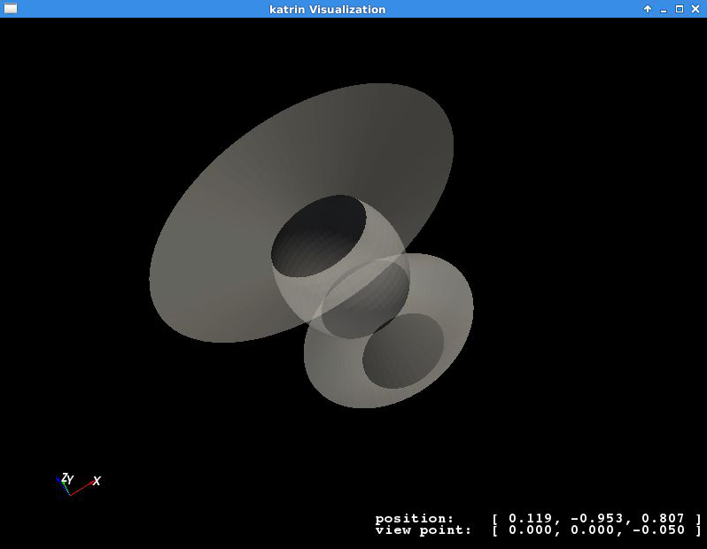
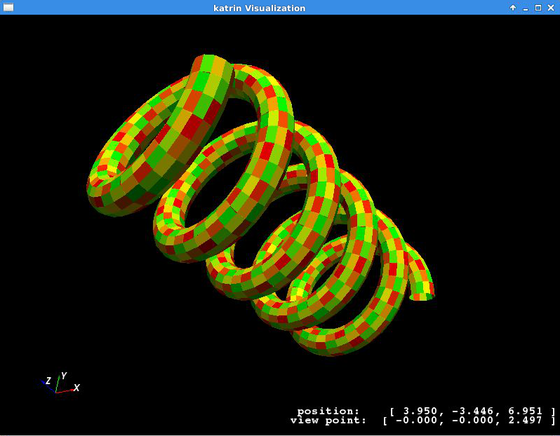

.. _basic-kgeobag-label:

Basic Shapes in KGeoBag
==========================

This section is a description of the basic spaces and surfaces which can be constructed using *KGeoBag*. All of the
following shapes can be displayed by the executables ``MeshViewer`` and ``GeometryViewer`` (see :ref:`visualization-label`).
These executables are built and installed along with *KGeoBag* when it is linked against VTK_.

Geometry visualization
-----------------------

In order to view a geometry you can execute ``GeometryViewer`` from the directory ``$KASPERSYS/install/bin`` with the
path to your geometry file (.xml) and the name of the geometry element you want to display as the arguments:

.. code-block:: bash

    ./GeometryViewer ../config/TheBag/Examples/ExampleShapes.xml example_rotated_surface

An example of the geometry view is shown below:

To visualized the mesh of a geometric element execute MeshViewer in ``$KASPERSYS/install/bin`` with the path to your
geometry file (.xml) and the name of the geometry element you want to display:

.. code-block:: bash

    ./MeshViewer <../config/TheBag/Examples/ExampleShapes.xml> <example_rotated_surface>

There is also an ``AxialMeshViewer`` available, which displays the axial mesh (if defined) in the same way. The
geometric element can be a specific element or several elements collected into a group. To display a single element use
its name, to show a tagged group the argument is written as ``@tag_group``. An example of the mesh viewer being used on
a rod surface is shown below:

The ``GeometryViewer`` and ``MeshViewer`` will also produce a VTK poly-data file (.vtp) which can then be open in the
external application Paraview_ for more advanced visualization.

The parameters specifying the method by which a geometric element is meshed must be given in the geometry file when the
shape is described. If no mesh is desired for some object, the mesh parameters may be ignored and the defaults will be
used. The commands above may also be tried with one of the *Kassiopeia* simulation examples.

The mesh parameters vary for each object, but essentially describe two properties (for each meshable dimension). These
are the ``mesh_count`` and the ``mesh_power``. If the ``mesh_power`` is set equal to 1.0, then the ``mesh_count`` simply
specifies the number of equally sized segments that a shape will be chopped into, along a particular dimension. If the
``mesh_power`` is greater than 1.0, then the density of segments will increase towards the edges of the shape while
keeping the number of elements the same. The ``mesh_power`` property is useful for tailoring the accuracy of mesh
descriptions for Laplace boundary value problems, where quantities such as charge density may vary considerably near the
sharp edges of an object. Therefore, this parameter is mainly used for electrode meshes.

The following sections provide examples and brief descriptions of some basic shapes available for use in *KGeoBag*.

Basic elements
--------------

The following elements (poly-loop and poly-line) are internal descriptors. They can't be used by themselves outside a
geometry element. This section serves as a brief explanation for the structure of these shapes.

Poly-loop
~~~~~~~~~~

.. xml-element:: poly_loop

Poly-line
~~~~~~~~~~

.. xml-element:: poly_line

Surfaces
-----------

Flat surfaces
~~~~~~~~~~~~~~

Flattened circle surface
"""""""""""""""""""""""""""

.. xml-element:: flattened_circle_surface

Flattened poly-loop surface
"""""""""""""""""""""""""""""

.. xml-element:: flattened_poly_loop_surface

Rotated Surfaces
~~~~~~~~~~~~~~~~~~

All rotated surfaces are constructed from lines, arcs, poly-lines, or poly-loops which are then rotated around the local
x-axis.

Rotated line segment surface
"""""""""""""""""""""""""""""""

.. xml-element:: rotated_line_segment_surface

Rotated arc segment surface
"""""""""""""""""""""""""""""

.. xml-element:: rotated_arc_segment_surface

Rotated poly-line surface
"""""""""""""""""""""""""""

.. xml-element:: rotated_poly_line_surface

Rotated circle surface
"""""""""""""""""""""""

.. xml-element:: rotated_circle_surface

Rotated poly loop surface
"""""""""""""""""""""""""""

.. xml-element:: rotated_poly_loop_surface

Shell Surfaces
~~~~~~~~~~~~~~~~~

All shell surfaces are lines, arcs or surfaces that are rotated around the x-axis between a given start angle
(angle_start) and stop angle (angle_stop).

Shell line segment surface
"""""""""""""""""""""""""""

.. xml-element:: shell_line_segment_surface

Shell arc segment surface
"""""""""""""""""""""""""""

.. xml-element:: shell_arc_segment_surface

Shell poly-line surface
"""""""""""""""""""""""""

.. xml-element:: shell_poly_line_surface

Shell circle surface
"""""""""""""""""""""

.. xml-element:: shell_circle_surface

Shell poly-loop surface
"""""""""""""""""""""""""

.. xml-element:: shell_poly_loop_surface

Extruded Surfaces
~~~~~~~~~~~~~~~~~~~

Extruded surfaces are surfaces that are extruded along the direction of the local z-axis from a minimum z-position
(zmin) to a maximum z-position (zmax).

Extruded poly-line surface
"""""""""""""""""""""""""""

.. xml-element:: extruded_poly_line_surface

Extruded circle surface
"""""""""""""""""""""""""

.. xml-element:: extruded_circle_surface

Extruded poly-loop surface
"""""""""""""""""""""""""""

.. xml-element:: extruded_poly_loop_surface

Special Surfaces
~~~~~~~~~~~~~~~~~

These surfaces are just specific cases of the more general surface types already listed. However, since their use is
extremely common, they have been made available as unique, special types. For many simple simulations, it is possible
to design the geometry entirely using these elements.

Disk surface
"""""""""""""

.. xml-element:: disk_surface

Annulus surface
"""""""""""""""""

.. xml-element:: annulus_surface

Cylinder surface
"""""""""""""""""

.. xml-element:: cylinder_surface

Cone Surface
"""""""""""""""

.. xml-element:: cone_surface

Cut Cone Surface
"""""""""""""""""

.. xml-element:: cut_cone_surface

Torus Surface
"""""""""""""""

.. xml-element:: torus_surface

Cut Torus Surface
"""""""""""""""""""

.. xml-element:: cut_torus_surface

Spaces
--------

Spaces are considered distinct from surfaces as they are (water-tight) volumes. The cannot be open or have holes which
puncture their boundaries. In the *Kassiopeia* interface, spaces are treated very differently than surfaces and have
different features on purposes.

Extruded Spaces
~~~~~~~~~~~~~~~~

Extruded spaces are from in a manner similar to extruded surfaces, the only difference being that they also provide
planar caps to fully enclose a central volume.

Extruded Circle Space
"""""""""""""""""""""""""

.. xml-element:: extruded_circle_space

Extruded Poly-Loop Space
"""""""""""""""""""""""""""

.. xml-element:: extruded_poly_loop_space

Rotated Spaces
~~~~~~~~~~~~~~~~

Rotated Line Segment
"""""""""""""""""""""

.. xml-element:: rotated_line_segment_space

Rotated Arc Segment
"""""""""""""""""""""

.. xml-element:: rotated_arc_segment_space

Rotated Poly-Line Space
"""""""""""""""""""""""""

.. xml-element:: rotated_poly_line_space

Rotated Circle Space
"""""""""""""""""""""

.. xml-element:: rotated_circle_space

Rotated Poly-Loop Space
"""""""""""""""""""""""""

.. xml-element:: rotated_poly_loop_space

Special Spaces
~~~~~~~~~~~~~~~~

These spaces are just specific cases of the more general space types already listed. They have been made separately
available because of their common use. As with the special surfaces, these elements may be used to design a simple
simulation geometry.

Cylinder Space
"""""""""""""""

.. xml-element:: cylinder_space

Cone Space
"""""""""""""

.. xml-element:: cone_space

Cut Cone Space
"""""""""""""""

.. xml-element:: cut_cone_space

Torus Space
"""""""""""""

.. xml-element:: torus_space

Cylinder Tube Space
"""""""""""""""""""""

.. xml-element:: cylinder_tube_space

Cut Cone Tube Space
"""""""""""""""""""""

.. xml-element:: cut_cone_tube_space

Box Space
"""""""""""""

.. xml-element:: box_space
